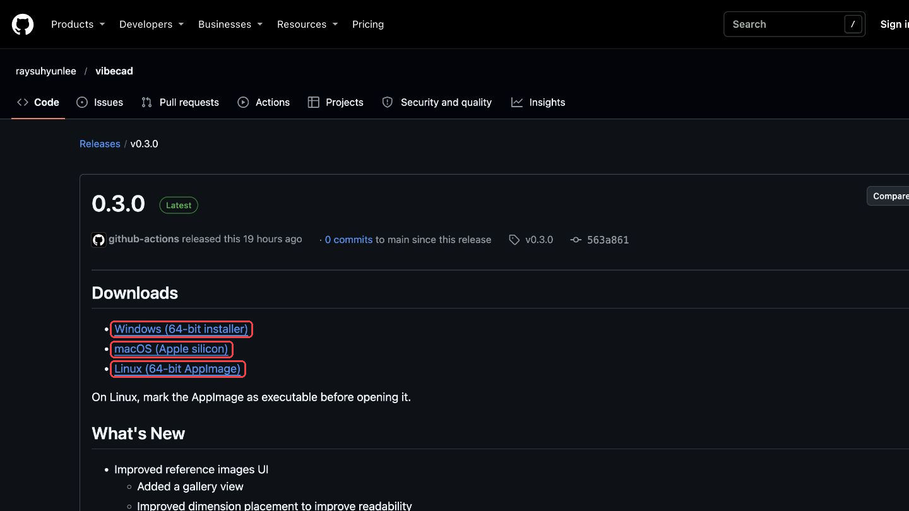

# 바이브캐드 설치 및 사용 가이드

바이브캐드는 에이전트와 대화하며 3D 부품을 설계하는 CAD입니다. 모델은 TypeScript 코드로 저장되고, 사람은 화면의 모델을 가리키며 말로 수정을 요청할 수 있습니다.

## 사전 준비물

- **Claude Code** 또는 **Codex** (바이브캐드는 자체 AI를 쓰지 않고 PC에 설치된 에이전트를 호출합니다.)

## 설치 방법

[최신 릴리스 페이지](https://github.com/raysuhyunlee/vibecad/releases/latest) 위쪽의 **Downloads**에서 플랫폼에 맞는 링크를 눌러 설치 파일을 받습니다.



- Windows 설치 파일은 서명되지 않아 SmartScreen 경고가 뜰 수 있습니다. `추가 정보` > `실행`을 누르세요.

## 사용 방법

앱을 열고 프로젝트로 쓸 폴더를 고릅니다. 화면은 세 영역으로 나뉩니다.


1. **왼쪽 패널**: 프로젝트의 모델 파일(`*.cad.ts`, STEP) 목록
2. **가운데 모델 뷰**: 열린 파일 탭과 3D 모델
3. **오른쪽 채팅**: 에이전트와 대화하는 곳

단축키: `D` 펜(면을 클릭해 핀 꽂기), `Space` 누른 채 말하기, `F` 화면 맞춤, `Esc` 선택 해제, `I` 모델과 사진 전환.

### 사진으로 설계 시작하기

새 파일 버튼으로 모델을 추가하고, 실물 사진이나 손 스케치를 올려 보세요. 에이전트가 필요한 치수를 사진 위에 표시해 물어봅니다. 버니어캘리퍼스 등으로 실측한 값을 채우고 `Update model`을 누르면 모델이 갱신됩니다.


### 에이전트 도구에서 CLI로 쓰기

바이브캐드의 모든 기능은 CLI로도 쓸 수 있어, 내장 채팅 없이 Claude Code나 Codex에서 바로 설계할 수 있습니다. 앱을 한 번 실행하면 `vibecad` 명령이 PATH에 등록됩니다. 새 터미널을 열어 `vibecad --help`가 되는지 확인하세요.

프로젝트 폴더에서 에이전트를 열고 이렇게 요청합니다.

```text
바이브캐드로 M3 나사 4개로 고정하는 SG90 서보 브래킷 설계해 줘.
```

에이전트가 만든 모델은 앱에서도 바로 열립니다.
