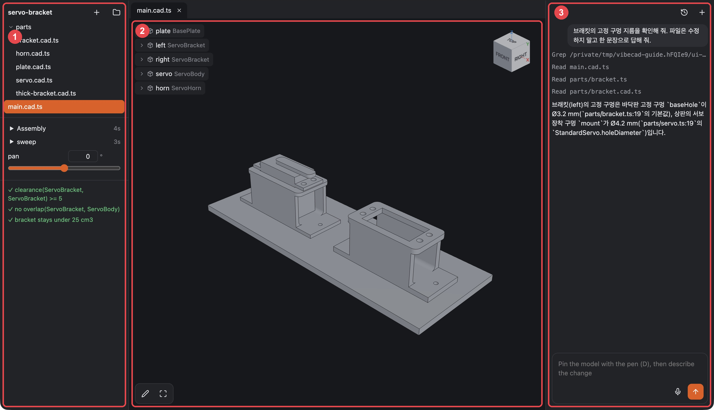
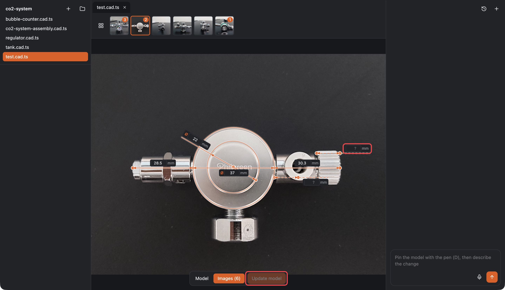

# 바이브캐드 설치 및 사용 가이드

바이브캐드는 에이전트와 대화하며 3D 부품을 설계하는 CAD입니다. 모델은 TypeScript 코드로 저장되고, 사람은 화면의 모델을 가리키며 말로 수정을 요청합니다.

## 사전 준비물

- **Claude Code** 또는 **Codex** CLI. 바이브캐드는 자체 AI를 쓰지 않고 PC에 설치된 에이전트를 호출합니다. 터미널에서 `claude` 또는 `codex`를 실행해 로그인까지 마쳐 두세요.

## 설치 방법

[최신 릴리스 페이지](https://github.com/raysuhyunlee/vibecad/releases/latest) 위쪽의 **Downloads**에서 플랫폼에 맞는 링크를 눌러 설치 파일을 받습니다.

| 플랫폼 | 파일 |
| --- | --- |
| macOS (Apple Silicon) | `Vibecad-<버전>-arm64.dmg` |
| Windows (x64) | `Vibecad-Setup-<버전>.exe` |
| Linux (x64) | `Vibecad-<버전>-x86_64.AppImage` |


- Windows 설치 파일은 서명되지 않아 SmartScreen 경고가 뜰 수 있습니다. `추가 정보` > `실행`을 누르세요.
- 새 버전이 나오면 앱이 알려 주고, `Install and Restart`로 업데이트합니다.

## 사용 방법

앱을 열고 프로젝트로 쓸 폴더를 고릅니다. 화면은 세 영역으로 나뉩니다.



1. **왼쪽 패널**: 프로젝트의 모델 파일(`*.cad.ts`, STEP) 목록과 새 파일 버튼. 조인트가 있으면 슬라이더, 선택한 피처의 소스, 설계 검사 결과도 여기에 나옵니다.
2. **가운데 모델 뷰**: 열린 파일 탭과 3D 모델. 왼쪽 위 모델 트리에서 파트와 피처를 고르고, 오른쪽 위 뷰 큐브로 방향을 바꿉니다. 면이나 모서리를 클릭하면 오른쪽 아래에 치수가 나옵니다.
3. **오른쪽 채팅**: 에이전트와 대화하는 곳. 마이크 버튼으로 말하거나 직접 입력합니다.

단축키: `D` 펜(면을 클릭해 핀 꽂기), `Space` 누른 채 말하기, `F` 화면 맞춤, `Esc` 선택 해제, `I` 모델과 사진 전환.

### 사진으로 설계 시작하기

새 파일 버튼으로 모델을 추가하고, 실물 사진이나 손 스케치를 올려 보세요. 에이전트가 초안을 만들고, 필요한 치수를 사진 위에 점선으로 물어봅니다. 값을 채우고 `Update model`을 누르면 모델이 갱신됩니다.



### 에이전트 도구에서 CLI로 쓰기

바이브캐드의 모든 기능은 CLI로도 쓸 수 있어, 내장 채팅 없이 Claude Code나 Codex에서 바로 설계할 수 있습니다. 앱을 한 번 실행하면 `vibecad` 명령이 PATH에 등록됩니다. 새 터미널을 열어 `vibecad --help`가 되는지 확인하세요.

프로젝트 폴더에서 에이전트를 열고 이렇게 요청합니다.

```text
바이브캐드로 M3 나사 4개로 고정하는 SG90 서보 브래킷 설계해 줘. vibecad --help 부터 확인해.
```

에이전트가 만든 모델은 앱에서도 바로 열립니다. 주요 명령: `build`, `test`, `render`, `export`(STEP/STL). 전체 목록은 `vibecad --help`.
